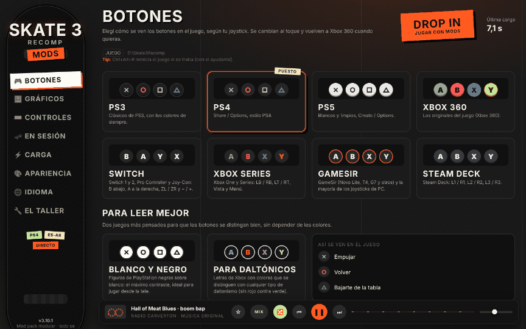

# 🛹 Skate 3 Recomp Mods 🎮

**🇬🇧 English** · [🇦🇷 Español](README.es.md) · [🇧🇷 Português](README.pt.md) · [🇫🇷 Français](README.fr.md) · [🇮🇹 Italiano](README.it.md) · [🇩🇪 Deutsch](README.de.md) · [🇨🇳 中文](README.zh.md) · [🇯🇵 日本語](README.ja.md)

A **modular** mod pack for [skate3recomp](https://github.com/mchughalex/skate3recomp): you download it all together and turn on only what you want. Every module is added and removed from **the modder**, a Skate 3-style window with its own radio, and everything can be undone.

> 🧩 **Requires [skate3recomp](https://github.com/mchughalex/skate3recomp) v2.0.2 and your own copy of Skate 3.** This is only the modder: it does not include the game or the recomp.

> ⚡ **From 16.6 s to ~7 s:** with *Straight to your save*, a patch inside the game has you skating in your save about 7 seconds after you hit **DROP IN**.

<p align="center"><br><sub>Recreation using the time of a real load: 6.9 s from DROP IN.</sub></p>


## ✨ What's inside

| Module | What it does |
|---|---|
| 🎮 **Button icons** | Swaps the Xbox 360 icons for your controller's: PS3, PS4, PS5, Switch (1 and 2, Pro, Joy-Con), Xbox Series, GameSir or Steam Deck, plus **black and white** (high contrast) and **colour-blind safe** |
| 🖼️ **Graphics presets** | Max quality, Balanced, Performance or Ultra light, in one click |
| 🖥️ **Screen** | VSync, fullscreen and which monitor the game opens on (great with two monitors) |
| ⏩ **Straight to your save** | A black loading screen covers the intro and the menus, a patch inside the game speeds up the whole startup, and you show up in your career in the language you pick |
| ⌨️ **Keyboard and mouse** | Turns on the recomp's keyboard+mouse mode, sensitivity, and remapping of every button by pressing the key |
| 🔭 **FOV and ultrawide** | Field of view (40–120) and 21:9 mode |
| 🛹 **Session helper** | Alt+F4, quick restart (Ctrl+Alt+R), high priority, screen always on, hidden cursor, Windows key blocked, remembered window and do not disturb |
| ⚡ **Loading** | Defender skipping the game, preload when the PC starts, moving the game to an SSD, a chart of your last 20 loads, your last load next to DROP IN and the load log one click away |
| 🌐 **Español ARG** | Adds "Español ARG" (voseo and Rioplatense vocabulary) in place of Dutch; the original Spanish stays the same |
| 🇧🇷 **Português (Brasil)** | The game's text in Portuguese for the direct load (about 13,600 strings) |
| 🔧 **The shop** | Shortcuts, Steam, play time, multiple recomp versions, repair, diagnostics, update and uninstall everything |
| 🎮 **Gamepad-friendly modder** | Works with a controller or the keyboard, fits your screen and comes with a radio with favourites, Mix and shuffle |

🌍 The modder is available in Español, English, Português (Brasil), Français, Italiano, Deutsch, 中文 and 日本語: it picks the Windows language by itself, and you can change it under **Language**.


| PS4 | PS5 |
|---|---|
|  |  |

## 📦 Installation (Windows)

1. ⬇️ Download `Skate3-Mods.zip` from [Releases](../../releases) and unzip it wherever you like (Downloads works).
2. 🖱️ Open `Skate3-Mods.exe`: it finds the skate3recomp folder by itself, copies itself there and remembers it. If it can't find it, it lets you pick it.
3. ✅ Turn on whatever you want.
4. 🛹 Play with **DROP IN**, the "Skate 3 (directo)" / "Skate 3 (normal)" shortcuts or `Jugar Skate 3 (mods).bat`. The session helper only runs if you start the game that way; icons, graphics and language work the same when you open `skate3.exe`.

> 🪟 The modder uses WebView2, which already ships with Windows 10 and 11. If it's missing, a console menu opens instead (also available with `Skate3-Mods.exe menu`).

> ⚠️ The game must have been installed at least once (*Select ISO* button). Close it before changing icons or presets.

> 🛡️ If SmartScreen shows up: "More info" ➡️ "Run anyway" (the .exe isn't signed).

## 🎮 Button icons

| 🟢 Xbox | 🔵 PlayStation |
|---|---|
| Ⓐ Ⓑ Ⓧ Ⓨ | ✖️ ⭕ 🟪 🔺 |
| LB / RB / LT / RT | L1 / R1 / L2 / R2 |
| LS / RS (click) | L3 / R3 |
| Back / Start | PS3: Select / Start · PS4: Share / Options · PS5: Create / Options |

Also: **Switch** (Switch 1 and 2, Pro Controller, Joy-Con), **Xbox Series** (View / Menu), **GameSir** (Nova Lite, T4, G7 and most PC controllers) and **Steam Deck**. For easier reading: **Black and white** (black PlayStation shapes on white) and **Colour-blind safe** (Xbox letters in Okabe-Ito colours, no red against green), with a preview of how they look in game. The Switch ones go by position: if you use Steam with "Use Nintendo Button Layout", A and B end up swapped.

The icons live in `game/data/big/fedynamic.big` ➡️ `buttons.rx2`. The mod keeps the original (`fedynamic.big.xbox-original`) and "Xbox (original)" restores it byte for byte. ➕ The D-Pad stays the same and the stick drawing in the Trick Guide still says "RS" (it's a different texture).

## 🖼️ Presets, FOV and ultrawide

They write values to `skate3.toml` (the same file the game's *Settings* menu uses, so you can keep tweaking there afterwards). The first time, your `skate3.toml` is saved as `skate3.toml.mods-original`; "Restore my previous settings" brings it back.

**Ultra light** turns off shadows, SSAO, bloom, sun rays, fog and MSAA, and shortens the draw distance: for really modest PCs. **Screen** writes `vsync`, `fullscreen` and `monitor` (0 = automatic, 1 = first screen, 2 = second...).

## ⌨️ Keyboard and mouse

Turns on the recomp's `mnk_mode`: the mouse moves the camera (right stick) and every controller button maps to a key. In **Controls** you tap a button and press the key or mouse click you want (if another button was already using it, they swap). "Back to default keys" restores the recomp's ones.

## ⏩ Straight to your save

Uses the recomp's own startup automation (`skate3_demo_path` with `skate3_demo_path_signed_in`, so it keeps your profile and your save): it skips the intro, accepts the language screen, Press Start and the startup notices, and lets go of the controls as soon as you start skating. Meanwhile, a black loading screen (with a tip shown with your button style and a bar that learns how long your load takes) covers the game and goes away as soon as you can play; the game stays muted until then. The language you pick goes in English's place inside `miscboot.big` while the option is on.

### 🧩 The direct load patch

With the option on, the modder puts `xinput9_1_0.dll` next to `skate3.exe`. The recomp loads it at startup (it passes the controller through to Windows' xinput, so the controls work the same) and, **only if `skate3.exe` is v2.0.2** (each patch is located through the exe's function table and verified byte for byte), it speeds up startup inside the game itself:

- 🚫 **EA logo** done at 0.03 s instead of ~4.7 s.
- 🏎️ **No FPS cap** while loading (your setting comes back once you're in the game).
- ⏱️ **Press Start** without its minimum wait and with START instantly.
- 😴 **Loaders without naps:** the loading threads stop sleeping 1 ms between each pass.
- 💓 **Game tick at 4 ms** during the short loading steps (instead of 16.7 ms).
- 🖤 **One-frame fades** and the graphics card at high priority until you reach the game.
- 📜 **`skate3-direct.log`** next to `skate3.exe`: how long each step took (opens from **Loading**).

With any other recomp version it doesn't touch anything. Turning the option off or uninstalling deletes it; if there was another `xinput9_1_0.dll` that isn't ours, it's left alone. Each part can be turned off with an environment variable (`SKATE3_DIRECT=0` turns the whole thing off). Details and code in [`dll/`](dll/).

| | Before | Now |
|---|---|---|
| ⏩ Full direct load | ~16.6 s | **~7 s** |

## ⚡ Loading

- 🛡️ **Windows Defender:** adds the game folder to the exclusions (asks for admin permission once), so it doesn't scan every file while loading.
- 🌅 **Preload when the PC starts:** when Windows starts, it reads the exe, the DLLs, the shader cache and the game files in the background, with no windows, so the first load of the day is fast too.
- 💽 **SSD:** if the game is on a hard disk and you have an SSD, it copies it to `X:\Skate3Recomp`, checks the size and updates shortcuts, Steam and preload; the old folder is deleted only if you ask.
- 📊 **History:** your last 20 loads against the 10 s mark and where the time went in each one; the latest shows up next to **DROP IN**.
- 📜 **Load log:** a button opens the game folder with `skate3-direct.log` selected.

## 🌐 Español ARG

On the game's language screen, "Nederlands" becomes **"Español ARG"**: the game's Spanish text rewritten with rules. "¿Quieres jugar? Puedes..." ➡️ "¿Querés jugar? Podés...", "Haz un kickflip y presiona Ⓐ" ➡️ "Hacé un kickflip y presioná Ⓐ", "colega" ➡️ "loco", "coches" ➡️ "autos", "piscina" ➡️ "pileta", "mola" ➡️ "garpa", and so on (about 2,700 strings). The original Spanish stays exactly as it is. The rules are in [`go/rioplatense.txt`](go/rioplatense.txt): if you spot something odd, that's where it gets fixed.

It only touches `miscboot.big` (saving it as `miscboot.big.original`); turning it off brings Dutch back, byte for byte.

## 🛹 Session helper

Runs in the background while you play and closes with the game. Each feature is turned on or off in **Session**:

- ⌨️ **Alt+F4** closes the game like the window's X.
- 🔁 **Ctrl+Alt+R** closes and reopens the game if it hangs.
- ⚡ **High priority** for the game process.
- ☀️ **Screen always on**, even if you only play with the controller.
- 🖱️ **Hidden cursor** over the game after 3 seconds without moving the mouse.
- 🪟 **Windows key blocked** while the game is in the foreground.
- 🗔 **Remembered window**: monitor, size and mode are saved on close.
- 🔕 **Do not disturb**: turns off Windows notifications and turns them back on when you quit.

## 🔧 The shop

- 🖱️ **Shortcuts:** "Skate 3 Mods", "Skate 3 (directo)" and "Skate 3 (normal)" on the desktop and in the Start menu, plus one per language.
- 🚂 **Steam:** Skate 3 in your library (Big Picture, Steam Input).
- ⏱️ **Play time** per day and per week.
- 🧪 **Recomp versions:** multiple game folders, each with its own mods and settings.
- 🩹 **Repair:** checks `fedynamic.big` and `miscboot.big` and fixes anything broken from the backup.
- 🔄 **After updating the recomp:** if a file changed, it's taken as the new original and your mods are applied again.
- 🩺 **Diagnostics** and 📣 **problem reports**, with the end of the game log.
- ⬇️ **Update:** downloads the new version from Releases and replaces itself.
- 💀 **Uninstall everything:** leaves the game exactly as it was before the mods.

## 📻 Radio Carverton

Boom bap, punk, rock, electro and cumbia generated live with Web Audio, different on every track and with a new one every time you open the modder (pick the genre or Mix, and shuffle). The M key pauses it. It uses no music files and no copyrighted tracks.

## ⚙️ How it works

- **Icons and text:** they replace only their own file inside the `.big` (appending the new version at the end); everything else stays intact.
- **Helper:** `Skate3-Mods.exe play` (used by DROP IN, the shortcuts, Steam and the `.bat`; `play direct` and `play normal` choose how it starts) opens the game and leaves a small windowless process that closes with the game.
- **Modder:** an HTML page embedded in the `.exe` (`go/ui/index.html`) running inside WebView2.
- 🚫 It doesn't include or distribute any EA files: the icons are original art and the mods are applied to your own copy of the game.

### 🐧 Linux / 🍎 macOS

The icons work with Python 3.8+ (no dependencies):

```sh
python3 src/skate3_ps_buttons.py install ps5 --game /path/to/skate3recomp
python3 src/skate3_ps_buttons.py uninstall    --game /path/to/skate3recomp
```

## 🛠️ Building

```sh
cd go && GOOS=windows GOARCH=amd64 go build -ldflags "-s -w -H windowsgui" -o ../dist/Skate3-Mods.exe .
```

The patch DLL: `cd dll && sh build.sh` (Linux, clang + lld). When a `v*` tag is pushed, GitHub Actions builds the `.exe` and uploads the zip to Releases.

## 🖌️ Regenerating the icons

```sh
pip install pillow numpy
python tools/build_payload.py preview/png   # redraws and regenerates src/payload.py and go/payload/
```

Font: Inter (SIL Open Font License, see `tools/fonts/Inter-LICENSE.txt`).

---

📝 [Changes in each version](CHANGELOG.md) · 🐛 [Report a problem](../../issues/new/choose)

📄 License in [`LICENSE`](LICENSE). Not affiliated with EA, Sony, Microsoft, Nintendo, Valve or the skate3recomp project. Skate 3 is a trademark of Electronic Arts.
