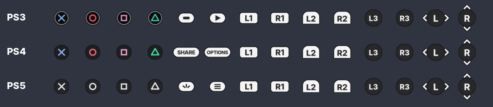
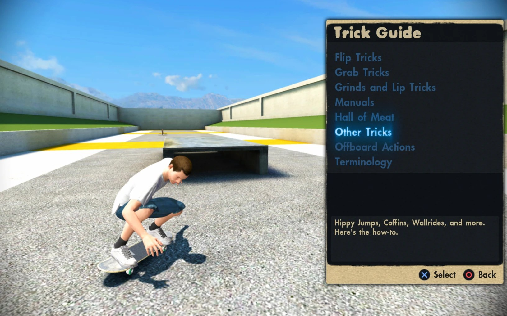
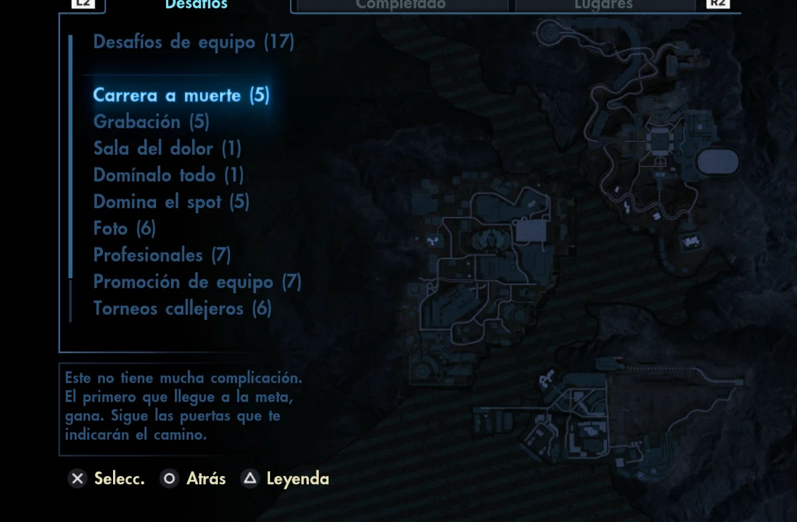

# 🛹 Skate 3 Recomp Mods 🎮

Pack de mods **modular** para [skate3recomp](https://github.com/mchughalex/skate3recomp): se baja todo junto y activás solo lo que quieras. Cada módulo se pone y se saca desde **el modeador**, una ventana con onda Skate 3 (pantalla completa, F11 la pasa a ventana) y radio propia con boom bap, punk, rock, electro y cumbia, sin tocar nada más.

| Módulo | Qué hace |
|---|---|
| 🎮 **Iconos PlayStation** | Cambia los iconos de Xbox por PS3, PS4 o PS5 |
| 🖼️ **Presets gráficos** | Máxima calidad, Equilibrado, Rendimiento o Ultra liviano, con un clic |
| 🖥️ **Pantalla** | VSync, pantalla completa y en qué monitor abre el juego (ideal con dos monitores) |
| ⏩ **Directo a tu partida** | Carga directa: una pantalla de carga tapa la intro y los menús, y aparecés en tu carrera, en el idioma que elijas |
| 🎮 **Modeador con joystick** | Se maneja con el mando (cruz, A, LB/RB, Start) o con atajos de teclado; se adapta solo a tu pantalla (tamaño a gusto y modo sofá); radio con favoritos, Mix y aleatorio; reportar un problema en un toque |
| ⌨️ **Teclado y mouse** | Activa el modo teclado+mouse del recomp, sensibilidad y remapeo de cada botón tocando la tecla |
| 🔭 **FOV y ultrawide** | Campo de visión (40–120) y modo 21:9 |
| 🛹 **Ayudante en sesión** | Alt+F4, reinicio rápido (Ctrl+Alt+R), prioridad alta, pantalla siempre encendida, cursor oculto, tecla Windows bloqueada, ventana recordada y no molestar |
| 🖥️ **Accesos directos** | "Skate 3 Mods" (el modeador), "Skate 3 (directo)" y "Skate 3 (normal)" en el escritorio |
| 🚂 **Skate 3 en Steam** | Lo suma a tu biblioteca como juego externo, para Big Picture, Steam Input y la captura de Steam |
| 🧉 **Español ARG** | Agrega el idioma "Español ARG" (voseo y vocabulario rioplatense) en lugar del neerlandés; el español original queda igual |

🔧 **El taller:** aviso cuando sale una versión nueva de skate3recomp, reparar archivos, reaplicar los mods solo si actualizás el recomp, diagnóstico, carpetas a mano, actualización en un toque y desinstalar todo.

➕ Sale en español o en inglés según el idioma de Windows.




| PS4 | PS5 |
|---|---|
|  |  |

## 📦 Instalación (Windows)

1. ⬇️ Descargá `Skate3-Mods.zip` desde [Releases](../../releases) y descomprimilo donde quieras (Descargas sirve).
2. 🖱️ Abrí `Skate3-Mods.exe`: se abre el modeador, busca solo la carpeta de skate3recomp, se copia ahí y la recuerda. Si no la encuentra, te deja elegirla.
3. ✅ Activá lo que quieras.
4. 🛹 Jugá con **DROP IN**, los accesos directos "Skate 3 (directo)" / "Skate 3 (normal)" o `Jugar Skate 3 (mods).bat`. El ayudante en sesión solo corre si abrís el juego así; iconos, gráficos e idioma funcionan igual abriendo `skate3.exe`.

> 🪟 El modeador usa WebView2, que ya viene con Windows 10 y 11. Si faltara, se abre el menú clásico de consola (también con `Skate3-Mods.exe menu`).

> ⚠️ El juego tiene que haberse instalado al menos una vez (botón *Select ISO*). Cerralo antes de cambiar iconos o presets.
> 🛡️ Si aparece SmartScreen: "Más información" ➡️ "Ejecutar de todas formas" (el .exe no está firmado).

## 🎮 Iconos PlayStation

| 🟢 Xbox | 🔵 PlayStation |
|---|---|
| Ⓐ Ⓑ Ⓧ Ⓨ | ✖️ ⭕ 🟪 🔺 |
| LB / RB / LT / RT | L1 / R1 / L2 / R2 |
| LS / RS (click) | L3 / R3 |
| Back / Start | PS3: Select / Start · PS4: Share / Options · PS5: Create / Options |

Los iconos están en `game/data/big/fedynamic.big` ➡️ `buttons.rx2`. El mod guarda el original (`fedynamic.big.xbox-original`) y al elegir "Xbox (original)" lo restaura byte a byte. ➕ El D-Pad queda igual y el dibujo del stick del Trick Guide sigue diciendo "RS" (es otra textura).

## 🖼️ Presets, FOV y ultrawide

Escriben valores en `skate3.toml` (el mismo archivo que usa el menú *Settings* del juego, así que después podés seguir ajustando ahí). La primera vez se guarda tu `skate3.toml` como `skate3.toml.mods-original`; "Volver a mi configuración de antes" lo restaura.

**Ultra liviano** apaga sombras, SSAO, bloom, rayos de sol, niebla y MSAA, y acorta la distancia de dibujado: para PCs muy justas. **Imagen** escribe `present_letterbox` (bandas negras) y `skate3_native_render_scene_ssr` (reflejos, experimental). **Pantalla** escribe `vsync`, `fullscreen` y `monitor` (0 = automática, 1 = primera pantalla, 2 = segunda...).

## ⌨️ Teclado y mouse

Activa `mnk_mode` del recomp: el mouse mueve la cámara (stick derecho) y cada botón del joystick va a una tecla. En **Controles** tocás un botón y apretás la tecla o el click que quieras (si ya la usaba otro botón, se intercambian). Se guardan como `keybind_*` en `skate3.toml`. "Volver a las teclas de fábrica" deja las del recomp.

## ⏩ Directo a tu partida

Usa la automatización de arranque del propio recomp (`skate3_demo_path` con `skate3_demo_path_signed_in`, así conserva tu perfil y tu partida): saltea la intro, acepta la pantalla de idioma, el Press Start y los avisos de arranque, y deja de tocar los controles en cuanto empezás a patinar. Mientras tanto, el ayudante tapa el monitor del juego con una pantalla de carga y la saca cuando el registro del juego (`logs/`, que con esta opción se escribe cada segundo) dice que ya estás patinando; si algo sale raro, se va sola a los 2 minutos. Esa automatización siempre acepta inglés, así que el idioma que elegís en el modeador (Español, Español ARG, Français, Deutsch, Italiano) se pone en el lugar del inglés dentro de `miscboot.big` mientras la opción está activa; al apagarla vuelve el original.

## 🧉 Español ARG

En la pantalla de idiomas del juego, "Nederlands" pasa a ser **"Español ARG"**. Ese idioma son los textos en español del juego reescritos con reglas: "¿Quieres jugar? Puedes..." ➡️ "¿Querés jugar? Podés...", "Haz un kickflip y presiona Ⓐ" ➡️ "Hacé un kickflip y presioná Ⓐ", "colega" ➡️ "loco", "coches" ➡️ "autos", "piscina" ➡️ "pileta", "mola" ➡️ "garpa", y así (unos 2700 textos). El español original queda tal cual. Las reglas están en [`go/rioplatense.txt`](go/rioplatense.txt): si ves algo raro, se corrige ahí.

Toca solo `miscboot.big` (lo guarda como `miscboot.big.original`); al desactivarlo vuelve el neerlandés, byte a byte.

## 🛹 Ayudante en sesión

Corre en segundo plano mientras jugás y se cierra con el juego. Cada cosa se prende o apaga en **En sesión**:

- ⌨️ **Alt+F4** cierra el juego como la X de la ventana (el recomp se come la tecla).
- 🔁 **Ctrl+Alt+R** cierra y vuelve a abrir el juego si se traba.
- ⚡ **Prioridad alta** para el proceso del juego.
- ☀️ **Pantalla siempre encendida**, aunque juegues solo con el mando.
- 🖱️ **Cursor oculto** sobre el juego a los 3 segundos sin mover el mouse.
- 🪟 **Tecla Windows bloqueada** mientras el juego está en primer plano.
- 🗔 **Ventana recordada**: monitor, tamaño y modo se guardan en `skate3.toml` al cerrar.
- 🔕 **No molestar**: apaga las notificaciones de Windows y las vuelve a prender al salir.

ℹ️ La intro ya se saltea con Enter o A (lo trae el recomp). No la salteamos sola porque el mismo toque podría pasar de largo la pantalla de idiomas.

## 🔧 El taller

- 🩹 **Reparar:** revisa `fedynamic.big` y `miscboot.big`; si alguno está roto, vuelve desde la copia y se reaplica el mod.
- 🔄 **Después de actualizar el recomp:** al jugar o abrir el modeador, si un archivo cambió, se toma como nuevo original y se vuelven a poner tus mods.
- 📜 **Registro del juego:** abre el log de la última sesión; el reporte de problemas incluye su final.
- 🩺 **Diagnóstico:** deja `Skate3-Mods-diagnostico.txt` en el escritorio para pedir ayuda.
- 📁 **Carpetas:** juego, partidas y datos, a un toque.
- ⬇️ **Actualizar:** baja la versión nueva de Releases y se reemplaza solo.
- 💀 **Desinstalar todo:** deja el juego exactamente como estaba antes de los mods.

## 📻 Radio Carverton

El modeador tiene radio: boom bap, punk, rock, electro y cumbia generados en vivo con Web Audio, distintos en cada tema (elegís el género o Mix, y aleatorio). Arranca sola al abrir el modeador, cada tema dura cerca de dos minutos y la tecla M la pausa. No usa ningún archivo de música ni temas con copyright.

## ⚙️ Cómo funciona

- **Iconos y textos:** reemplazan solo su archivo dentro del `.big` (agregan la versión nueva al final); el resto queda intacto.
- **Ayudante:** `Skate3-Mods.exe play` (lo usan DROP IN, los accesos directos, Steam y el `.bat`; `play direct` y `play normal` eligen cómo arranca) abre el juego y deja corriendo un proceso chico sin ventana que se cierra con el juego.
- **Modeador:** una página HTML embebida en el `.exe` (`go/ui/index.html`) dentro de WebView2.
- 🚫 No incluye ni distribuye archivos de EA: los iconos son arte original, los textos se generan con reglas sobre tu propia copia.

### 🐧 Linux / 🍎 macOS

Los iconos funcionan con Python 3.8+ (sin dependencias):

```sh
python3 src/skate3_ps_buttons.py install ps5 --game /ruta/a/skate3recomp
python3 src/skate3_ps_buttons.py uninstall    --game /ruta/a/skate3recomp
```

## 🛠️ Compilar

```sh
cd go && GOOS=windows GOARCH=amd64 go build -ldflags "-s -w -H windowsgui" -o ../dist/Skate3-Mods.exe .
```

Al publicar un tag `v*`, GitHub Actions compila el `.exe` y sube el zip a Releases.

## 🖌️ Regenerar los iconos

```sh
pip install pillow numpy
python tools/build_payload.py preview/png   # redibuja y regenera src/payload.py y go/payload/
```

Fuente: Inter (SIL Open Font License, ver `tools/fonts/Inter-LICENSE.txt`).

---

### 🇬🇧 English

Modular mod pack for skate3recomp with a Skate 3 styled modder window (and its own generated-beats radio): PlayStation button icons (PS3/PS4/PS5), graphics presets (including an ultra light one), FOV/ultrawide, VSync/fullscreen/which monitor the game opens on, keyboard and mouse play with click-to-remap keys, an in-game helper (Alt+F4, Ctrl+Alt+R quick restart, high priority, keep awake, hidden cursor, Windows key block, window memory, do not disturb), desktop shortcuts, a Steam (non-Steam game) entry, a "straight to your save" direct load behind a loading screen, an "Español ARG" (Rioplatense Spanish) language in Dutch's slot, and a shop with a skate3recomp new-version notice, repair, auto re-apply after recomp updates, diagnostics, one-click update and uninstall-all. Unzip anywhere and run `Skate3-Mods.exe` (it finds the skate3recomp folder by itself and copies itself there) to toggle modules, then hit DROP IN (or use the "Skate 3 (directo)" / "Skate 3 (normal)" shortcuts) so the helper runs. Every module is reversible. Not affiliated with EA, Sony or the skate3recomp project.
